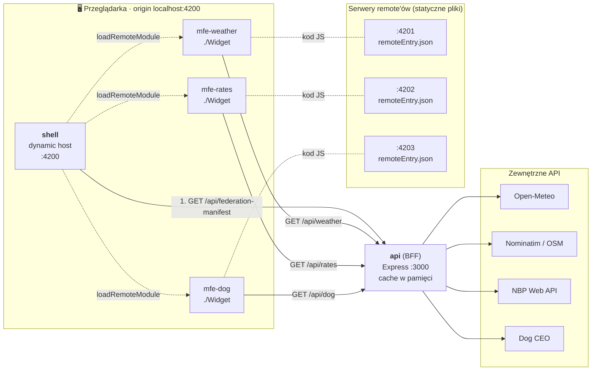
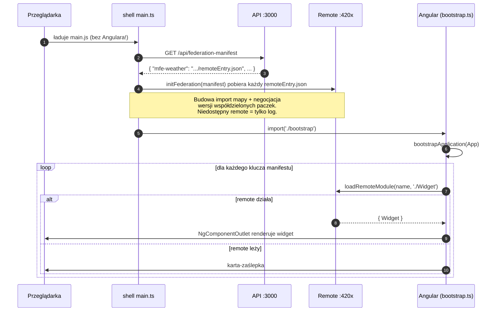

<div align="center">

# ☀️ Poranny Pulpit

**Spokojny poranny pulpit złożony z trzech mikrofrontendów.**
Pogoda, kursy walut i pies dnia: każdy widget to osobna aplikacja Angular, a shell tylko je składa.


</div>

---

## Spis treści

- [Cel projektu](#-cel-projektu)
- [Funkcjonalności](#-funkcjonalności)
- [Architektura](#-architektura)
- [Jak działa federacja w tym projekcie](#-jak-działa-federacja-w-tym-projekcie)
- [Technologie](#-technologie)
- [Uruchomienie](#-uruchomienie)
- [Testy](#-testy)
- [Struktura repo](#-struktura-repo)
- [Ćwiczenia](#-ćwiczenia)

---

## 🎯 Cel projektu

Projekt edukacyjny do przećwiczenia **mikrofrontendów w Angularze z użyciem Native Federation**.
Celowo jest **jak najprostszy**: bez NgRx, bez bibliotek UI, wykresów czy dat, bez warstw abstrakcji.
Każdy plik istnieje dlatego, że uczy czegoś o federacji.

Główne lekcje:

| Lekcja | Gdzie ją widać |
|---|---|
| Remote to pełnoprawna aplikacja | `ng serve mfe-weather` pokazuje sam widget |
| Shell nie zna remote'ów w czasie budowania | manifest pobierany z API przy starcie |
| Awaria jednego remote'a nie psuje reszty | karta-zaślepka „Ten widget jest chwilowo niedostępny” |
| Angular ładuje się raz dla wszystkich | zakładka Network: jeden `_angular_core…js` |
| CSS custom properties przechodzą przez granice MFE | tokeny tylko w `shell/src/styles.css` |
| Deploy remote'a bez przebudowy shella | zmień tekst w remote, przebuduj tylko go, odśwież shell |

---

## ✨ Funkcjonalności

**Shell (host)**
- Powitanie zależne od pory dnia („Dzień dobry” / „Dobry wieczór”) i pełna data po polsku.
- Dynamiczne ładowanie widgetów w kolejności z manifestu.
- Skeleton podczas ładowania remote'a i elegancka zaślepka, gdy remote nie odpowiada.
- Siatka 3 kolumny (desktop) → 2 (tablet) → 1 (telefon), tryb ciemny, `prefers-reduced-motion`.

**🌤 Pogoda (`mfe-weather`)**
- Lokalizacja z przeglądarki (niska dokładność, zaokrąglona do ~1 km już na froncie).
- Brak zgody / timeout 5 s / brak wsparcia → Warszawa z dopiskiem „lokalizacja domyślna”.
- Duża temperatura, opis słowny, odczuwalna, min/max i ręcznie rysowany wykres SVG na 12 h.

**💱 Kursy (`mfe-rates`)**
- EUR, USD, CHF, GBP z tabeli A NBP: kurs, zmiana % (stonowana zieleń/czerwień), sparkline z 10 notowań.
- W weekend pokazuje ostatnie dostępne notowanie z jego datą.

**🐕 Pies dnia (`mfe-dog`)**
- Jeden losowy pies na dzień (odświeżenie strony go nie zmienia), rasa i żartobliwy podpis.

**API (BFF)**
- Normalizuje dane z Open-Meteo, Nominatim, NBP i Dog CEO, cache'uje je w pamięci.
- Gdy zewnętrzne API leży: zwraca ostatnie dane z cache, a bez nich `502`.
- Nominatim zgodnie z regulaminem: `User-Agent` z kontaktem, max 1 zapytanie/s, cache 7 dni.

---

## 🏗 Architektura



Ten sam schemat w ASCII:

```
                         ┌──────────────── przeglądarka (origin :4200) ───────────────┐
                         │                                                            │
  GET manifest  ┌────────┴──────┐  loadRemoteModule('mfe-*', './Widget')             │
 ┌──────────────┤  shell :4200  ├──────────┬──────────────────┬──────────────┐       │
 │              └───────────────┘          ▼                  ▼              ▼       │
 │                                 ┌──────────────┐  ┌──────────────┐  ┌──────────────┐
 │                                 │ mfe-weather  │  │  mfe-rates   │  │   mfe-dog    │
 │                                 │ kod z :4201  │  │ kod z :4202  │  │ kod z :4203  │
 │                                 └──────┬───────┘  └──────┬───────┘  └──────┬───────┘
 │                                        │ /api/weather    │ /api/rates      │ /api/dog
 ▼                                        ▼                 ▼                 ▼
┌─────────────────────────────────── api :3000 (Express, BFF, cache) ─────────────────┐
└──────┬──────────────────┬───────────────────┬────────────────────┬──────────────────┘
       ▼                  ▼                   ▼                    ▼
   Open-Meteo        Nominatim (OSM)      NBP Web API          Dog CEO API
```

### Porty

| Aplikacja | Port | Rola |
|---|---|---|
| `shell` | **4200** | host (dynamic-host), składa pulpit |
| `mfe-weather` | **4201** | remote, widget pogody |
| `mfe-rates` | **4202** | remote, widget kursów |
| `mfe-dog` | **4203** | remote, widget psa dnia |
| `api` | **3000** | Node + Express, BFF |

---

## 🔌 Jak działa federacja w tym projekcie

### Sekwencja startu shella



### Kluczowe pliki (czytaj w tej kolejności)

| # | Plik | Czego uczy |
|---|---|---|
| 1 | [`projects/mfe-dog/federation.config.mjs`](projects/mfe-dog/federation.config.mjs) | co remote **wystawia** (`exposes: './Widget'`) i co **współdzieli** (`shared`) |
| 2 | [`projects/shell/federation.config.mjs`](projects/shell/federation.config.mjs) | host nie ma `exposes`, tylko `shared` |
| 3 | [`api/server.js`](api/server.js) → `FEDERATION_MANIFEST` | skąd shell wie, gdzie są remote'y |
| 4 | [`projects/shell/src/main.ts`](projects/shell/src/main.ts) | `initFederation` **przed** załadowaniem Angulara |
| 5 | [`projects/shell/src/bootstrap.ts`](projects/shell/src/bootstrap.ts) | przekazanie manifestu i loadera do DI |
| 6 | [`projects/shell/src/app/remote-widget.ts`](projects/shell/src/app/remote-widget.ts) | `loadRemoteModule` + `NgComponentOutlet` + obsługa błędu per widget |
| 7 | [`projects/mfe-dog/src/main.ts`](projects/mfe-dog/src/main.ts) | jak remote startuje samodzielnie |
| 8 | [`projects/mfe-dog/src/styles.css`](projects/mfe-dog/src/styles.css) | świadoma kopia tokenów (fallback dla trybu standalone) |

### Kontrakt shell ↔ remote

Każdy remote wystawia **dokładnie jedną rzecz**: standalone komponent `Widget` pod kluczem `./Widget`.
Komponent sam pobiera dane z API, nie przyjmuje inputów i nic nie wie o shellu ani innych widgetach.
Widgety używają natywnego `fetch` + `resource()`, a nie `HttpClient`, więc nie wymagają od hosta żadnych providerów.

---

## 🧰 Technologie

| Obszar | Technologia | Po co |
|---|---|---|
| Frontend | **Angular 22.2** (standalone, signals, `resource()`, `@if`/`@for`, zoneless) | framework dla shella i remote'ów |
| Mikrofrontendy | **@angular-architects/native-federation 22.2** (Native Federation v4) | federacja oparta na ES modules i import maps |
| Runtime federacji | `@softarc/native-federation-orchestrator`, `es-module-shims` | ładowanie remote'ów, shim import map |
| Build | Angular CLI + esbuild (`@angular/build`) | builder federacji deleguje do ApplicationBuildera |
| Backend | **Node 24** + **Express 5** (ESM, natywny `fetch`, `--env-file`) | BFF z cache w pamięci |
| Testy frontu | **Vitest 5** + jsdom (builder `@angular/build:unit-test`) | testy komponentów i funkcji |
| Testy API | `node:test` (wbudowany w Node) | testy bez dodatkowych paczek |
| Dev | `concurrently` | jedno `npm start` dla 5 procesów |
| Wygląd | CSS custom properties, Google Fonts (*Fraunces* + *Inter*), inline SVG | bez bibliotek UI i wykresów |
| Dane | Open-Meteo, Nominatim (OSM), NBP Web API, Dog CEO | darmowe publiczne API |

---

## 🚀 Uruchomienie

Wymagania: **Node 24+** (używamy `import.meta.main` i `--env-file-if-exists`).

```bash
npm install          # instaluje też zależności api/ (postinstall)
cp api/.env.example api/.env   # wpisz swój email do NOMINATIM_CONTACT
npm start            # API + 3 remote'y + shell, kolorowe prefiksy w logach
```

Otwórz **http://localhost:4200**.

Osobne skrypty:

| Skrypt | Co uruchamia |
|---|---|
| `npm run start:api` | API na :3000 |
| `npm run start:shell` | shell na :4200 |
| `npm run start:weather` | `mfe-weather` na :4201 |
| `npm run start:rates` | `mfe-rates` na :4202 |
| `npm run start:dog` | `mfe-dog` na :4203 |
| `npm run build` | build produkcyjny wszystkich aplikacji do `dist/` |

> 💡 `api/.env` jest w `.gitignore`. Email trafia tylko do nagłówka `User-Agent` zapytań backend → Nominatim, nigdy do frontu.

---

## 🧪 Testy

```bash
npm test             # wszystko: API + 4 aplikacje Angular
npm run test:api     # tylko API (node:test)
npm run test:ng      # tylko Angular (Vitest)
```

| Projekt | Co jest testowane |
|---|---|
| `api` | parsowanie i zaokrąglanie współrzędnych, mapowanie kodów WMO, normalizacja pogody i kursów, nazwa rasy z URL, cache (TTL, stale-on-error, limit wpisów), throttle Nominatim, CORS, manifest, `502` |
| `shell` | powitanie i data, render slotu per wpis manifestu, `RemoteWidget`: sukces / skeleton / zaślepka (loader podmieniony przez DI) |
| `mfe-weather` | geolokalizacja (zgoda, odmowa, brak wsparcia, timeout), URL do API, render karty, „Twoja okolica”, wykres SVG |
| `mfe-rates` | formatowanie `pl-PL`, trend, wiersze walut, data notowania, błąd API |
| `mfe-dog` | render zdjęcia, rasy i podpisu, skeleton, błąd API |

> W testach `shell` federacja jest zastąpiona fałszywym loaderem przez token `LOAD_REMOTE`, więc testy nie potrzebują działających remote'ów.

---

## 📁 Struktura repo

```
poranny-pulpit/
├── projects/
│   ├── shell/                  # host, :4200
│   │   ├── federation.config.mjs
│   │   └── src/
│   │       ├── main.ts         # manifest z API → initFederation → bootstrap
│   │       ├── bootstrap.ts
│   │       ├── styles.css      # design tokens (jedyne źródło prawdy)
│   │       └── app/
│   │           ├── app.ts      # nagłówek + siatka
│   │           ├── remote-widget.ts
│   │           └── remotes.ts  # tokeny DI
│   ├── mfe-weather/            # remote, :4201
│   │   ├── federation.config.mjs   # exposes './Widget'
│   │   └── src/app/
│   │       ├── app.ts          # root tylko dla trybu standalone
│   │       ├── widget.ts       # ← to wystawiamy
│   │       └── chart.ts
│   ├── mfe-rates/              # remote, :4202 (ta sama budowa)
│   └── mfe-dog/                # remote, :4203 (ta sama budowa)
├── api/
│   ├── server.js               # Express BFF
│   ├── server.test.js
│   └── .env.example
├── angular.json
└── package.json
```

---

## 🏋️ Ćwiczenia

1. **Shared dependencies:** obejrzyj `federation.config.mjs` i zakładkę Network. Zobacz, że Angular ładuje się raz. Potem w jednym remote wyłącz współdzielenie jakiejś biblioteki i porównaj.
2. **Konflikt wersji:** wydziel jeden remote do osobnego `package.json` z inną wersją biblioteki i zobacz, co się dzieje.
3. **Komunikacja między MFE:** kliknięcie waluty w `mfe-rates` przelicza „ile kosztuje karma dla psa w tej walucie” w `mfe-dog`. Zrób przez `CustomEvent` na `window`, bez wspólnego serwisu.
4. **Nowy remote w innym frameworku:** dodaj `mfe-quote` w React (Native Federation ma adapter esbuild) i dopisz go do manifestu.
5. **Feature flag:** API zwraca różne manifesty zależnie od parametru (`?beta=1`).
6. **Origin i uprawnienia przeglądarki:** zezwól na lokalizację w shellu (`:4200`), a potem uruchom `mfe-weather` samodzielnie (`:4201`) i zobacz, że przeglądarka pyta ponownie. Kod remote'a załadowany przez federację wykonuje się w originie hosta, więc dziedziczy jego uprawnienia, localStorage i cookies. Zastanów się, co to oznacza dla bezpieczeństwa.
7. **Deploy:** wrzuć remote'y na osobne hostingi statyczne i podmień URL-e w manifeście.

---

<div align="center">
<sub>Pogoda: <a href="https://open-meteo.com/">Open-Meteo.com</a> · Lokalizacja: © <a href="https://www.openstreetmap.org/copyright">OpenStreetMap contributors</a> · Kursy: <a href="https://api.nbp.pl/">NBP</a> · Psy: <a href="https://dog.ceo/dog-api/">Dog CEO</a></sub>
</div>
